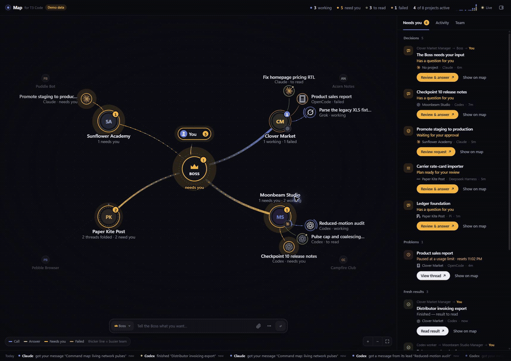
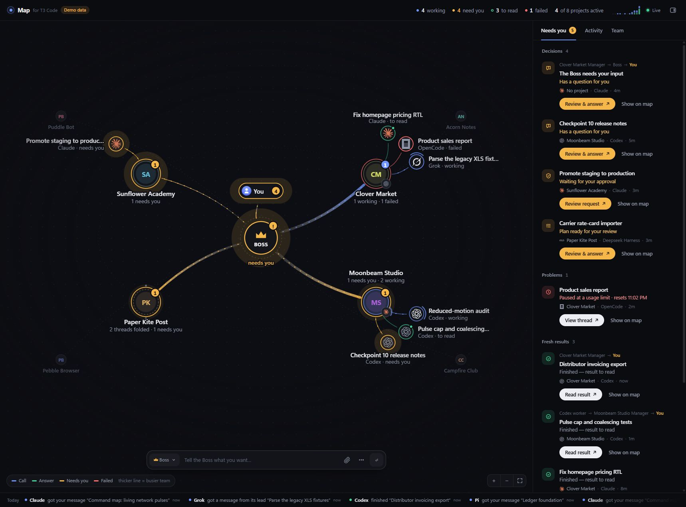

# T3 Map

A calm, live command map for T3 Code. Read conversations and steer the team without leaving the map. T3 remains the engine for agents, delegation, council, scheduling and approvals.



*Preview uses fictional demo data. Projects, repositories, conversations and decisions are simulated.*

Static screenshot




## Desktop app (Windows)

The Tauri desktop app includes the Node runtime and the existing map. It starts its own local bridge and stops it when the app exits. T3 Code must still be installed and running for live projects; demo mode never connects to it.

To build locally, install Node 22 or later, Rust with the Windows MSVC build tools, and WebView2, then run:

```powershell
npm ci
npm run desktop:build
```

The Windows installer is written to `src-tauri/target/release/bundle/nsis/`. The installed app does not need a separate Node installation. The build bundles the Node executable used to run the preparation script, together with its license notices.

For development, run `npm run desktop:dev`. To try it with fictional projects:

```powershell
$env:T3_MAP_DEMO = '1'
npm run desktop:dev
```

Desktop packaging currently targets Windows. The browser version remains available:

## Run in a browser

```powershell
npm start            # http://127.0.0.1:4773
```

On Windows, double-click `T3 Map.cmd`. Requirements: Node 22 or later and T3 Code running locally. The T3 window can stay in the background.

For an interactive demo that never connects to T3:

```powershell
$env:T3_MAP_DEMO = '1'
npm start            # http://127.0.0.1:4774
```

The demo is clearly labelled. Its questions, approvals, conversations and changes are simulated.

## Use it

- Click a project or its trunk to chat with its pinned Manager. Projects without a Manager get one Codex GPT-6.1 thread on first selection; repeated clicks reuse it. Use the small −/+ control to fold its threads, or double-click the project to zoom into the team. Escape returns to all projects. Folds are remembered.
- Click a thread, activity entry, or decision card to open its conversation beside the map. Earlier work is folded into a “Worked for…” row. Escape or Back to map closes the panel.
- Reply in the panel. Replies queue after an active run rather than interrupting it. Unsent drafts stay available while switching threads in the current page.
- Paste a screenshot, use the paperclip, or drop images into either composer. Each image appears as an inline chip at the cursor and a removable thumbnail. You can place different images beside different sentences, including files with the same name. Click a chip or thumbnail for a full-size preview.
- Images upload through T3's native pending-attachment service. The message carries the actual attachments and matching context records, so agents receive T3's inline image references. Image-only messages work too. Upload errors preserve the draft and offer retry; removing a thumbnail removes its inline chips.
- The live Tasks card above the reply box shows T3's actual checklist, current step, completed count and progress. Collapse it to make more room. User screenshots remain visible even when a long tool run pushes their timeline item out of the detail window.
- Answer questions, approve or deny supported requests with feedback, and accept proposed plans. Approval labels and warnings come from T3; stale requests are rejected.
- Stop active work, mark a finished result read, or settle an inactive thread. Settling removes it from the active map.
- The Changes tab shows T3’s checkpoint diff through the latest available completed turn. It does not merge or publish changes.
- Pick a project in Tell the team to start work directly. The options button lets you choose a starred agent/model pair and an optional new worktree with a base ref and branch. Project default remains available.

## Your team: Boss and Managers

The Boss and Managers are ordinary T3 threads with a short written brief. T3 does the coordination itself: Managers hand work to workers with `delegate_task`, threads talk to each other with `t3_thread_send`, and only the Boss asks you questions. The map adds the org chart, routing and the decision view.

- **Team tab → Set up a Boss.** Start a new thread (pick a starred agent; Opus is recommended) or promote an existing one. It gets the Boss brief and is pinned in T3. The Boss sits at the centre of the map with You above it.
- **Assign a Manager per project.** Start one (Codex recommended) or promote an existing thread from that project. Its avatar sits on the project node; its workers fan out under the project.
- **Autonomy per project:** Cautious, Normal (default) or Bold. Changing it sends the Manager a one-line update.
- **Decision rights.** Role briefs read `~/.t3-map/policy.md`; place your decision policy there before setting up the team. It overrides autonomy levels. Workers ask their Manager; `Decision:` is a timed heads-up to the Boss, while `Decision needed (user):` requires explicit user approval. Needs-you items show the path, e.g. "Clover Market Manager → Boss → You", and the Boss's questions are listed first.
- **Tell the team** messages the Boss by default, or the project's Manager when you're zoomed into a project. Tick "Start a separate thread instead" in options for one-off work.
- Merging, deploying and deleting stay yours: every brief says so, and the map has no button for them.

The roster lives in `~/.t3-map/team.json`, which the Boss re-reads to reach Managers. Removing a role only edits the roster; the thread stays in T3.

The radial map retains real event pulses, interactive curved links, project focus, zoom, dark and light themes, and a narrow conversation layout.
Provider marks use the same OpenAI, Claude, Grok, OpenCode, Pi, Cursor and ACP vectors as T3 Code. Terminal glyphs identify terminal/watch activities; an unknown provider gets initials. The vector attribution is in `THIRD_PARTY_NOTICES.md`.

## Connection and access

The bridge binds to `127.0.0.1`. It discovers T3 through `~/.t3/userdata/server-runtime.json`, issues a scoped session, and connects through `/api/auth/websocket-ticket` and T3’s Effect RPC WebSocket.

The session uses `orchestration:read` and `orchestration:operate`, expires after 30 days, and renews automatically. It stays in `~/.t3-map/session.json`; the bearer token never reaches the browser. A prior read-only map session is replaced and revoked on upgrade.

Live controls change real T3 threads. Starting or replying can run agents with that thread’s existing permissions. The map has no rollback, delete, merge, deployment or direct terminal controls. Host checks, same-origin JSON actions, request validation and frame protection keep other web pages from driving the local bridge.

To revoke access, use `t3 auth session list`, then `t3 auth session revoke <id>` for the session labelled `t3-map`.

## Current limits

- T3 must keep running as the backend. Provider sign-in still needs the provider’s own window.
- The conversation uses T3’s available projection, which can omit older history. The panel labels partial history and shortened answers/work. It renders common chat Markdown and native image attachments. Arbitrary local-file image links still require T3 filesystem permission, which this bridge does not request.
- PNG, JPEG, GIF and WebP images are supported: up to 10 MiB each, 80 MiB total and 100 per message, matching T3's limits. Uploads and unsent image drafts survive switching threads within the current page. A page reload clears unsent drafts; a bridge restart or expired upload may require reattaching an image.
- Changes require T3 checkpoints and may exclude a currently running turn. Large diffs are shortened and labelled.
- The API is a T3 client contract rather than a separately versioned extension API. Nightly changes can require an adapter update. Compare `packages/contracts/src/orchestrationV2.ts`, `checkpointDiff.ts` and `packages/client-runtime/src/operations/commands.ts` in the T3 source.

## Develop and verify

```powershell
npm test
npm run desktop:test   # Windows: prepare bundled files and run Rust checks
```

Desktop checks cover independent bridge ports, origin validation, parent-exit cleanup, navigation restrictions, and Windows path handling. Native window interaction remains a manual acceptance step.

The checks cover state/event mapping, conversation projection, safe Markdown, RPC success/failure/timeout behavior, and the HTTP demo flows with the same validation used for live actions. Browser acceptance covered question answers, denial with feedback, plan acceptance, replies, changes, new work with agent/worktree choices, stop, settle and draft retention; desktop dark/light and 390px layouts were inspected. Live checks read real conversations, starred agents and checkpoint diffs. Command schemas were checked against T3 using a nonexistent thread, so no real work was altered for that check.
Image checks cover two same-named files with distinct inline positions/bindings, image-only messages, protected previews, invalid uploads and cross-origin rejection. Browser checks exercised attachment input, the paste event, two-image sending, new-work images, preview/close and draft retention. Live upload/read/delete preserved the exact bytes of a real screenshot, and image send/launch payloads reached the expected nonexistent-thread/project rejection. No real agent was started for those transport checks.

- `server/t3.mjs`: T3 discovery, session, RPC and CLI adapter.
- `server/model.mjs`: map states and events.
- `server/thread.mjs`: conversation projection.
- `server/images.mjs`: validated native image upload and context bindings.
- `server/index.mjs`: HTTP, SSE and validated actions.
- `server/demo.mjs`: isolated simulated engine.
- `web/`: zero-dependency UI and conversation panel.
- `web/composer.js`: shared image-aware editor, inline chips and preview.
